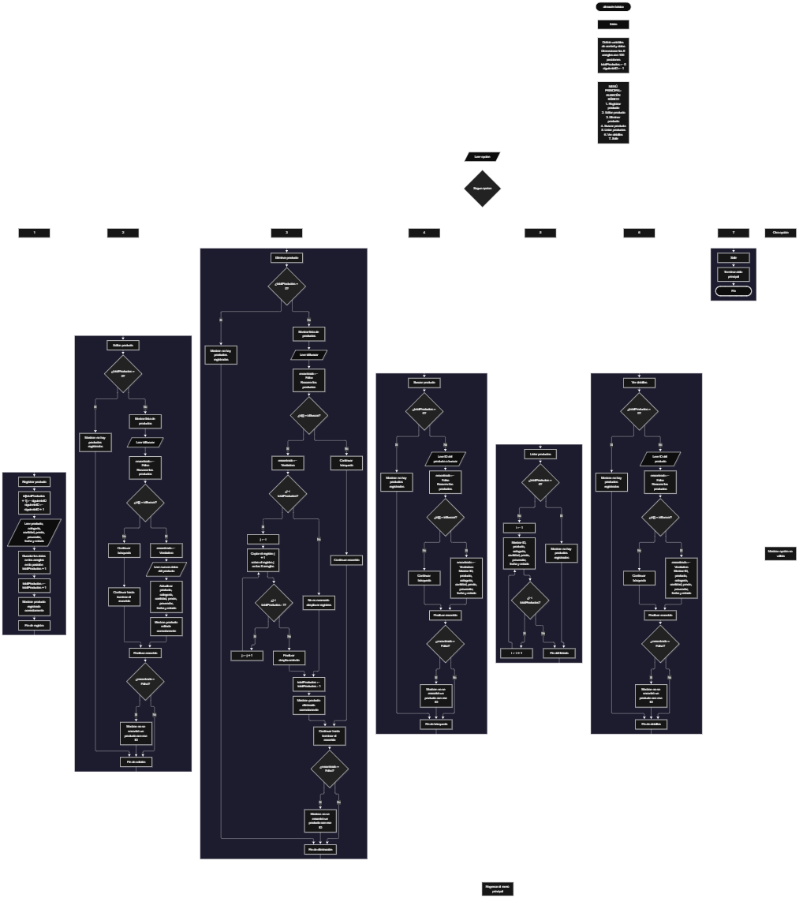

 

Este proyecto, llamado <b>almacén básico</b>, fue desarrollado en <b>pseint</b> como un ejercicio práctico para fortalecer la lógica de programación mediante la creación de un sistema de gestión de inventario desde la consola. El programa cuenta con un menú principal de siete opciones que permite <b>registrar, editar, eliminar, buscar, listar y consultar los detalles</b> de los productos registrados. Cada producto almacena datos como el identificador, nombre, categoría, cantidad, precio, proveedor, fecha de ingreso y estado, utilizando ocho arreglos con una capacidad de <b>100 posiciones cada uno</b>. Durante su desarrollo se aplicaron conceptos fundamentales de programación, como variables, arreglos, estructuras condicionales, ciclos repetitivos y estructuras de selección, además de procesos para buscar, modificar, eliminar y organizar registros. Este proyecto permite poner en práctica los conocimientos adquiridos en PSeInt y sirve como base para desarrollar sistemas de gestión de inventario más avanzados utilizando otros lenguajes y tecnologías.

<h2 align="center">⚙️ Funcionamiento del menú principal</h2>

### ➕ Registrar producto

La opción <b>1) registrar producto</b> permite registrar un nuevo artículo en el inventario. Al comenzar, el programa utiliza la variable <b>siguienteID</b> para asignar automáticamente un identificador al producto, almacenándolo en la posición correspondiente del arreglo <b>id</b>. Después, incrementa esta variable en uno para preparar el identificador del próximo registro. A continuación, solicita el <b>nombre del producto, categoría, cantidad, precio, proveedor, fecha de ingreso y estado</b>, almacenando cada dato en la posición correspondiente de su respectivo arreglo. Finalmente, aumenta la variable <b>totalProductos</b> en uno y muestra el mensaje <b>"producto registrado correctamente."</b>. Los arreglos tienen una capacidad de 100 posiciones, aunque el código actual todavía no comprueba si se ha alcanzado ese límite antes de permitir un nuevo registro.

### ✏️ Editar producto

La opción <b>2) editar producto</b> permite modificar la información de un producto registrado. Primero, el programa comprueba si existen productos almacenados mediante la variable <b>totalProductos</b>. Si no hay registros, muestra el mensaje <b>"no hay productos registrados."</b>. En caso contrario, presenta una lista con el identificador, nombre, categoría, cantidad, precio, proveedor, fecha y estado de cada producto. Después, solicita el identificador del producto que se desea editar e inicializa la variable lógica <b>encontrado</b> con el valor <b>falso</b>. Mediante un ciclo <b>para</b>, recorre los identificadores almacenados y los compara con el valor introducido por el usuario. Si encuentra una coincidencia, cambia la variable <b>encontrado</b> a <b>verdadero</b> y solicita los nuevos datos del producto, actualizando directamente los valores de los arreglos correspondientes. Finalmente, muestra el mensaje <b>"producto editado correctamente."</b>. Si el identificador no corresponde a ningún producto registrado, presenta el mensaje <b>"no se encontró un producto con ese id."</b>.

### 🗑️ Eliminar producto

La opción <b>3) eliminar producto</b> permite eliminar un artículo registrado mediante su identificador. Antes de comenzar, el programa comprueba si existen productos almacenados. Si el inventario está vacío, muestra el mensaje <b>"no hay productos registrados."</b>. Si hay registros disponibles, presenta una lista con los datos de los productos y solicita el identificador del artículo que se desea eliminar. Después, inicializa la variable lógica <b>encontrado</b> con el valor <b>falso</b> y utiliza un ciclo <b>para</b> para localizar el identificador solicitado. Cuando encuentra una coincidencia, cambia la variable a <b>verdadero</b>. Si el producto no se encuentra en la última posición, utiliza otro ciclo <b>para</b>, controlado por la variable <b>j</b>, para desplazar una posición hacia atrás los datos de los productos posteriores en los ocho arreglos: <b>id, producto, categoria, cantidad, precio, proveedor, fecha y estado</b>. Posteriormente, disminuye la variable <b>totalProductos</b> en uno y muestra el mensaje <b>"producto eliminado correctamente."</b>. Si el identificador no corresponde a ningún producto registrado, muestra el mensaje <b>"no se encontró un producto con ese id."</b>. El código actual continúa el recorrido del ciclo exterior después de eliminar un producto, por lo que conviene ajustar este comportamiento para evitar problemas durante la búsqueda y reorganización de los registros.

### 🔎 Buscar producto

La opción <b>4) buscar producto</b> permite localizar un artículo mediante su identificador. Primero, el programa comprueba si existen productos registrados. Si el inventario está vacío, muestra el mensaje <b>"no hay productos registrados."</b>. En caso contrario, solicita el identificador del producto que se desea buscar e inicializa la variable lógica <b>encontrado</b> con el valor <b>falso</b>. A continuación, utiliza un ciclo <b>para</b> para recorrer el arreglo <b>id</b> y comparar cada identificador mediante la condición <b>id[i] = idBuscar</b>. Cuando encuentra una coincidencia, cambia la variable <b>encontrado</b> a <b>verdadero</b> y muestra el identificador, nombre, categoría, cantidad, precio, proveedor, fecha y estado del producto. Si termina el recorrido sin encontrar coincidencias, presenta el mensaje <b>"no se encontró un producto con ese id."</b>. Esta función facilita la consulta de un registro específico sin necesidad de revisar manualmente todos los productos almacenados.

### 📋 Listar productos

La opción <b>5) listar productos</b> permite visualizar todos los productos registrados actualmente en el inventario. Antes de mostrar la información, el programa comprueba si la variable <b>totalProductos</b> es igual a cero. Si no existen registros, presenta el mensaje <b>"no hay productos registrados."</b>. Si hay productos disponibles, muestra el encabezado <b>"datos registrados"</b> y utiliza un ciclo <b>para</b> para recorrer los arreglos desde la primera posición hasta el número total de productos registrados. Durante el recorrido, presenta el identificador, nombre, categoría, cantidad, precio, proveedor, fecha y estado de cada artículo. Esta función permite consultar los registros existentes de manera general sin necesidad de buscar cada producto individualmente.

### 📄 Ver detalles del producto

La opción <b>6) ver detalles del producto</b> permite consultar toda la información de un artículo específico. Primero, el programa comprueba si existen productos registrados. Si el inventario está vacío, muestra el mensaje <b>"no hay productos registrados."</b>. En caso contrario, solicita el identificador del producto que se desea consultar e inicializa la variable lógica <b>encontrado</b> con el valor <b>falso</b>. Después, utiliza un ciclo <b>para</b> para recorrer los identificadores y compararlos con el valor introducido por el usuario. Si encuentra una coincidencia, cambia la variable a <b>verdadero</b> y presenta los datos de forma individual: <b>identificador, producto, categoría, cantidad, precio, proveedor, fecha y estado</b>. Si el identificador no corresponde a ningún registro, muestra el mensaje <b>"no se encontró un producto con ese id."</b>. Esta opción facilita la consulta detallada y organizada de la información de cada artículo.

### 🚪 Salir del menú principal

La opción <b>7) salir</b> permite finalizar la ejecución del programa y muestra el mensaje <b>"gracias por utilizar almacen basico."</b>. El menú principal se encuentra dentro de una estructura repetitiva <b>repetir ... hasta que</b>, que mantiene el programa en funcionamiento mientras el usuario realiza las operaciones disponibles. En el código actual, la condición final es <b>hasta que opcion = 7</b>, coincidiendo con la opción de salida definida en el menú. Por este motivo, cuando el usuario selecciona la opción 7, el ciclo termina y el programa finaliza correctamente.

<h2 align="center">🧠 Temas aplicados en el proyecto</h2>

### 📦 Variables

En este proyecto se utilizan variables para guardar la opción seleccionada en el menú, controlar la cantidad de productos registrados, recorrer los arreglos, identificar los productos que se desean editar, eliminar o consultar, almacenar el identificador que se desea buscar y comprobar si se encontró una coincidencia. También se utilizan variables para asignar identificadores consecutivos y almacenar los datos de los productos. Cada variable cumple una función específica dentro de las operaciones de gestión del inventario.

🔢 **Opcion:** Almacena la opción seleccionada por el usuario en el menú principal.

📊 **TotalProductos:** Almacena la cantidad actual de productos registrados.

🔄 **I:** Funciona como contador en los ciclos <b>para</b> y permite seleccionar la posición de un producto.

🔁 **J:** Controla el recorrido utilizado para desplazar los datos durante la eliminación de un producto.

🔎 **IdBuscar:** Almacena el identificador introducido por el usuario para localizar un producto.

🆔 **SiguienteID:** Determina el identificador que se asignará al próximo producto registrado.

✅ **Encontrado:** Variable lógica que indica si se encontró un producto con el identificador solicitado.

📝 **Producto:** Se utiliza como arreglo para almacenar los nombres de los productos.

📂 **Categoria:** Se utiliza como arreglo para almacenar las categorías de los productos.

📦 **Cantidad:** Se utiliza como arreglo para almacenar las cantidades registradas.

💰 **Precio:** Se utiliza como arreglo para almacenar los precios de los productos.

🚚 **Proveedor:** Se utiliza como arreglo para almacenar los proveedores de los productos.

📅 **Fecha:** Se utiliza como arreglo para almacenar las fechas de ingreso.

📌 **Estado:** Se utiliza como arreglo para almacenar el estado de cada producto.

### 🗃️ Arreglos

En este proyecto se utilizan ocho arreglos relacionados con los datos de cada producto. Cada arreglo tiene una capacidad de <b>100 posiciones</b> y utiliza el mismo índice para representar la información correspondiente a un mismo artículo. Por ejemplo, los datos de un producto almacenado en la posición <b>1</b> se encuentran distribuidos entre <b>id[1], producto[1], categoria[1], cantidad[1], precio[1], proveedor[1], fecha[1] y estado[1]</b>. Esta organización permite recorrer, buscar, modificar, mostrar y eliminar los productos de manera ordenada. La cantidad de registros activos se controla mediante la variable <b>totalProductos</b>.

🆔 **Id[100]:** Almacena los identificadores de los productos registrados.

📝 **Producto[100]:** Almacena los nombres de los productos.

📂 **Categoria[100]:** Almacena las categorías de los productos.

📦 **Cantidad[100]:** Almacena las cantidades de los productos.

💰 **Precio[100]:** Almacena los precios de los productos.

🚚 **Proveedor[100]:** Almacena los nombres de los proveedores.

📅 **Fecha[100]:** Almacena las fechas de ingreso de los productos.

📌 **Estado[100]:** Almacena los estados de los productos.

### 🔀 Estructuras condicionales

En este proyecto se utilizan las estructuras <b>si</b> y <b>sino</b> para comprobar si existen productos registrados antes de realizar determinadas operaciones, verificar si un identificador coincide con alguno de los productos almacenados y determinar si se encontró el artículo solicitado. También se utilizan condiciones para comprobar si el producto que se desea eliminar se encuentra antes de la última posición, lo que permite decidir si es necesario desplazar los datos de los registros posteriores. Estas condiciones permiten que el programa responda de manera diferente según el estado del inventario y el resultado de cada operación.

### 🔄 Estructuras repetitivas

En este proyecto se utilizan los ciclos <b>para</b> y <b>repetir ... hasta que</b>. Los ciclos <b>para</b> permiten recorrer los arreglos para mostrar los productos, buscar identificadores, editar registros y consultar los detalles de los artículos. Durante la eliminación, también se utilizan para desplazar los datos de los productos posteriores una posición hacia atrás. Por otro lado, el ciclo <b>repetir ... hasta que</b> mantiene activo el menú principal para que el usuario pueda ejecutar diferentes operaciones antes de salir del programa al seleccionar la opción 7.

### 🎯 Estructura segun

El programa evalúa el valor almacenado en la variable <b>opcion</b> mediante la estructura <b>segun</b> y ejecuta el bloque de instrucciones correspondiente. Cada caso representa una operación específica del sistema: <b>registrar, editar, eliminar, buscar, listar, ver detalles o salir</b>. También se utiliza el bloque <b>de otro modo</b> para mostrar el mensaje <b>"opción no válida."</b> cuando el usuario introduce un número que no coincide con ninguna de las opciones definidas en el menú.

### 🔢 Dimensionamiento de arreglos

El programa utiliza la instrucción <b>dimension</b> para establecer la capacidad de los arreglos que almacenan la información de los productos. Se definieron <b>100 posiciones para cada uno de los ocho arreglos</b>, lo que proporciona espacio para almacenar hasta 100 productos durante la ejecución. La cantidad de posiciones ocupadas se controla mediante la variable <b>totalProductos</b>, por lo que las operaciones recorren los registros comprendidos entre la primera posición y el total actual de productos. Sin embargo, el código actual todavía no comprueba si se ha alcanzado la capacidad máxima antes de registrar un nuevo producto.

### 🔄 Reorganización de registros

Cuando se selecciona un producto para eliminarlo, el programa utiliza un ciclo <b>para</b> que comienza en la posición seleccionada y llega hasta <b>totalProductos - 1</b>. En cada repetición, los datos de la posición siguiente se copian sobre la posición actual en los ocho arreglos: <b>id, producto, categoria, cantidad, precio, proveedor, fecha y estado</b>. Después, la variable <b>totalProductos</b> disminuye en uno. De esta manera, los productos posteriores ocupan las posiciones disponibles sin dejar huecos entre los registros activos. Los identificadores se conservan porque el programa desplaza los datos completos de cada producto sin generar nuevos identificadores durante la eliminación.

<h2 align="center">¿Cómo se implementaron las operaciones crud en el proyecto?</h2>

Las operaciones <b>crud</b> se implementaron mediante las opciones del menú principal, permitiendo administrar los productos registrados en el inventario. La operación <b>crear</b> corresponde a <b>registrar producto</b>, donde se asigna un identificador y se introducen los datos de un nuevo artículo; <b>leer</b> se realiza mediante las opciones <b>buscar producto, listar productos y ver detalles del producto</b>; <b>actualizar</b> corresponde a <b>editar producto</b>, donde se modifican los datos de un artículo registrado; y <b>eliminar</b> se realiza mediante la opción <b>eliminar producto</b>, que retira el registro y reorganiza las posiciones de los arreglos. Estas operaciones utilizan variables, arreglos, condicionales y ciclos para gestionar la información almacenada temporalmente durante la ejecución del programa.

<h2 align="center">Diagrama de flujo del proyecto</h2>

<h2 align="center">🛡️ Validaciones del programa</h2>

### 📭 No existen productos registrados

Esta validación se utiliza en las opciones de <b>editar, eliminar, buscar, listar y ver detalles del producto</b>. El programa comprueba si la variable <b>totalProductos</b> es igual a <b>0</b> y, si no existen productos registrados, muestra el mensaje <b>"no hay productos registrados."</b>. Esta comprobación evita continuar con las operaciones que necesitan información almacenada cuando el inventario está vacío.

### ❌ Producto no encontrado

Esta validación se utiliza durante las operaciones de <b>editar, eliminar, buscar y ver detalles del producto</b>. El programa inicializa la variable lógica <b>encontrado</b> con el valor <b>falso</b> y recorre el arreglo <b>id</b> para comparar los identificadores almacenados con el valor introducido por el usuario. Cuando encuentra una coincidencia, cambia la variable a <b>verdadero</b> y ejecuta la operación correspondiente. Si al finalizar el recorrido la variable continúa siendo <b>falso</b>, muestra el mensaje <b>"no se encontró un producto con ese id."</b>.

### ⚠️ Opción inválida

La estructura <b>segun</b> incluye el bloque <b>de otro modo</b>, que muestra el mensaje <b>"opción no válida."</b> cuando el usuario introduce un número que no corresponde a ninguna de las opciones definidas en el menú. Esta comprobación permite informar al usuario de que debe seleccionar una de las opciones disponibles. El código actual no incluye una validación específica para comprobar que la entrada sea un número entero antes de almacenarla en la variable <b>opcion</b>.

### 🔢 Identificación de productos

El programa utiliza la variable <b>idBuscar</b> para almacenar el identificador introducido por el usuario y compararlo con los valores del arreglo <b>id</b>. Esta comprobación permite localizar el producto que se desea editar, eliminar, buscar o consultar. La variable lógica <b>encontrado</b> indica si existe una coincidencia. El identificador permanece asociado al producto incluso cuando su posición en los arreglos cambia como consecuencia de una eliminación.

### ⚠️ Capacidad máxima del inventario

Los arreglos del programa tienen una capacidad de <b>100 posiciones</b>. Sin embargo, el código actual no comprueba si la variable <b>totalProductos</b> ha alcanzado el límite antes de registrar un nuevo producto. Por esta razón, todavía no existe una validación que impida superar la capacidad definida para los arreglos. Se recomienda incorporar esta comprobación para evitar accesos a posiciones fuera de los límites establecidos.

<h2 align="center">🎯 Objetivo del proyecto</h2>

El objetivo principal de este proyecto es fortalecer la <b>lógica de programación</b> mediante el desarrollo de un sistema de gestión de inventario en <b>pseint</b>. A través de su construcción se busca aplicar los conocimientos adquiridos sobre variables, arreglos, estructuras condicionales, ciclos repetitivos y estructuras de selección, integrándolos para resolver un problema de manera organizada. Además, el proyecto permite comprender cómo registrar, consultar, modificar y eliminar información de productos mediante identificadores y arreglos relacionados, estableciendo una base para desarrollar sistemas de gestión de inventario más completos con otros lenguajes y tecnologías.

